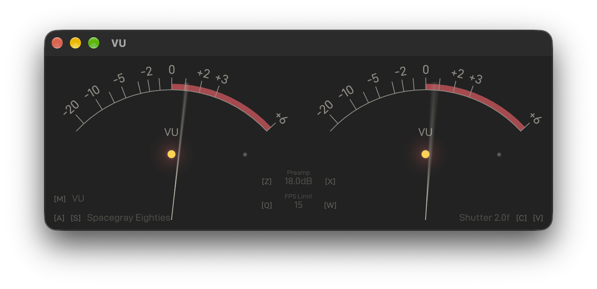

# VU

A stereo audio meter with VU, quasi-peak PPM, RMS, and sample-peak modes.



## Requirements

- Rust: https://rustup.rs/
- A GPU with compute support for Vello's wgpu renderer.

## Run

Run with `cargo run --release`

On macOS, allow system audio recording when prompted.

## Hotkeys

- `M` - cycles VU, BBC-style PPM, custom 300 ms RMS, and Sample Peak.
- `N` - In PPM and Sample Peak, switches the physical needle between **Full Spec**
and **Vintage FR**, the two Sifam response curves.
- `A` / `S` - cycle backward or forward through Cordex's 41 selected Gogh themes.
- `Z` / `X` - decrease or increase preamp by 6 dB, or 1 dB while holding `Shift`.
- `Q` / `W` - cycle backward or forward
through the frame rate limits: 30, 48, 55, 60, 72, 90, 120, 180, 240, and VSync.
- `C` / `V` - decrease or increase shutter exposure by half a frame, from 1 to 16
frame intervals. 

## Modes

- **VU:** sine-calibrated rectified-average drive into a moving-coil model. The
  movement reaches 99% of a step in 300 ms and overshoots by 1.25%. Its deflection
  is proportional to amplitude, with a fixed scale from -20 to +6 VU.
- **PPM:** BBC-style quasi-peak detection with parallel slow and fast charging
  envelopes. The detector reads a 10 ms, 5 kHz tone burst approximately 2 dB below
  a sustained tone and returns by 26 dB in 3 seconds. Its physical needle follows
  the selected Sifam movement curve. Full Spec reaches about full deflection at
  100 ms, with approximately 5.4% overswing near 136 ms and settling around
  250 ms. Vintage FR is slower with less overswing. Pointer
  overswing can make its maximum indication exceed the detector's reading.
- **RMS:** a 300 ms rectangular mean-square window followed by a critically damped
  needle. This is the custom meter, with two temporal responses in series.
- **Sample Peak:** detects absolute sample peaks, holds them for 100 ms, and then
  returns at 20 dB per second, driving the same Sifam-style physical movement.
  It measures stored samples; it does not reconstruct intersample true peaks.

Preamp applies to every mode. In the dBFS modes, amplitude 1 after preamp is
0 dBFS; a full-scale sine therefore reads about -3.01 dBFS in RMS mode. For VU,
0 VU corresponds to a sine with RMS amplitude 1 after preamp.

In the dBFS modes, drag horizontally to adjust the dB range, or vertically to adjust
the scale bend. VU keeps its fixed amplitude-proportional scale.
Double-click to reset both values to the default range (53.4 dB) and bend
(2.0).

## Config

- macOS: `~/Library/Application Support/com.zezic.vu/vu-config.ron`
- Linux: `$XDG_CONFIG_HOME/vu/vu-config.ron` (normally `~/.config/vu/vu-config.ron`)
- Windows: `%APPDATA%\zezic\vu\config\vu-config.ron`

## Audio Capture Details

On macOS 14.6+, a native Core Audio tap captures the stereo mix of all applications,
including playback through duplex interfaces and virtual devices such as BlackHole.
On Windows, CPAL WASAPI loopback captures the default output; restart VU after
changing that output or its sample rate.

On Linux, VU records the default input source. While VU is running, use your audio
system's routing UI to select the desktop output's monitor as VU's recording source.
For example, in `pavucontrol`, open the Recording tab and select "Monitor of ..."
for VU's stream. VU uses PulseAudio (including PipeWire's PulseAudio compatibility
service) when available, and otherwise uses the default ALSA input.

Mono output feeds both needles. For multichannel output, the meter analyzes the first
two channels as left and right.

## Development

Run the signal conversion and meter tests with `cargo test`.

Run the headless meter rendering test with
`cargo test renders_stereo_scales_text_needles_and_overload -- --ignored`.
Verify every mode in both layouts with
`cargo test renders_all_measurement_modes_and_units_in_both_layouts -- --ignored`.
Set `VU_MODE_PREVIEW_PREFIX` to a path prefix to save PNG previews for both
needle movements and layouts.
These tests use synthetic levels and do not initialize audio capture. Set
`VU_RENDER_PREVIEW_PATH` to a PNG path to save the horizontal frame and a
`.vertical.png` companion for the stacked layout.

Gauge faces and text are rasterized by Vello and retained on the GPU until the
view, a displayed setting, or a fading readout changes. A single GPU render pass
combines that cached image with the moving needles, motion blur, and overload
lamps. Needle parameters use inline GPU constants when supported and a retained
uniform buffer otherwise.

## Profiling

Build with `cargo build --release`, then run `target/release/vu --profile`.
This opens the normal window at a 240 FPS limit with synthetic stereo audio and
zero preamp. It warms up for one second, measures for ten seconds, and exits.
The summary reports the GPU and pixel extent, achieved FPS, base rasterizations,
scene construction time, and presentation time split into drawable acquisition,
rasterization, and submission. These are wall-clock timings; acquisition can wait for display
synchronization. A second line reports actual process and main-thread CPU usage,
excluding warmup. Here 100% means one fully busy core, and process usage includes
all of VU's threads. Resize the window during warmup to compare sizes;
keep it visible throughout measurement. The run skips audio capture and leaves
saved settings untouched.

Base rasterizations count Vello work for the retained scales and labels. Zero
during steady needle motion is expected: the overlay still renders every frame.
The `rasterize` stage measures that base work; `submit` includes the combined
GPU pass and presentation submission.

On macOS, measure process CPU time with
`/usr/bin/time -lp target/release/vu --profile`. Divide `user + sys` by `real`
and multiply by 100 for average CPU usage, where 100% means one fully busy core.
This external average includes startup and warmup. For a stack sample:

```sh
target/release/vu --profile &
vu_pid=$!
sample "$vu_pid" 8 1 -file /tmp/vu.sample.txt
wait "$vu_pid"
```

To isolate rendering from the window and presentation loop, run
`cargo test --release profiles_moving_needles_at_240_fps -- --ignored --nocapture`.
It drives the meter's audio processor, motion, retained background, and GPU
overlay for 1,200 measured frames after warmup. Set `VU_PROFILE_MAX_RENDER_US`
to a positive per-frame microsecond budget to make it fail when rendering
exceeds that budget. Use release builds and compare runs on the same GPU.

The ignored `overlay_matches_vector_stroke_sweep_mask_and_overload` test compares
the overlay against vector rendering at rest, during rapid motion, in both layouts,
and after zooming, including subpixel strokes and overload gradients.

## Embedding

The crate exports its existing renderer, measurement modes, scales, themes, and
text layouts as a library. Feed borrowed output samples to `Meter::consume_buf`.
`Meter::update_gauges` uses the same detectors, lamp history, motion, stop contact,
permanent bending, shutter exposure and subpixel appearance comparison as the
standalone application's `Meter::draw`. `Meter::draw_gauge_faces` draws the same
scales, stop dots and lamp recesses at host-supplied transforms.

`meter::SWEEP_SHADER` supplies the shared geometric sweep-wing coverage and radial
opacity functions. `meter::ShutterWindow` supplies the frame-based shutter window
used by recorded motion sources.
